# Awesome Creative Cloud Application Manager 🚀

  

 

**Curated collection of SaaS platforms, enterprise endpoint self-service portals, and open-source application distribution pipelines.**

*Optimize client software deployment, automate patch rollouts, streamline zero-touch provisioning, and distribute apps across macOS, Windows, and Linux.*

---

## 📑 Table of Contents

- [📊 Sector Overview & Market Dynamics](#-sector-overview--market-dynamics)
- [☁️ SaaS & Hosted Platforms](#️-saas--hosted-platforms)
- [💻 Open-Source Software & GitHub Projects](#-open-source-software--github-projects)
  - [Featured Self-Hosting Solutions](#featured-self-hosting-solutions)
  - [Open-Source Package & Fleet Managers](#open-source-package--fleet-managers)
- [🤝 How to Contribute](#-how-to-contribute)
- [💖 Support & Sponsorship](#-support--sponsorship)
- [⭐ Star History](#-star-history)
- [⚠️ Disclaimer](#️-disclaimer)

---

## 📊 Sector Overview & Market Dynamics

The global **Unified Endpoint Management (UEM)** and **self-service software distribution portal** market is projected to reach **$8.7B–$10.5B in 2026**, registering a Compound Annual Growth Rate (CAGR) of **~18–22%**. This accelerated expansion is catalyzed by distributed hybrid workforces, multi-operating system estates (macOS, Windows, Linux, iOS, Android), and stringent Zero-Trust compliance frameworks.

The market structure is **moderately concentrated**:
* **The Consolidated Enterprise Tier**: Titans such as **Microsoft (Intune)** and **VMware / Omnissa (Workspace ONE)** anchor massive global corporate accounts by tightly bundling endpoint controls into unified identity, productivity, and cloud security contracts.
* **Specialized & Disruptive Challenger Tier**: High-growth challengers like **NinjaOne**, **Jamf**, **ManageEngine (Zoho)**, **Rippling**, and **Kandji (Iru)** capture substantial market share by engineering superior workflows tailored for Apple ecosystem depth, Managed Service Providers (MSPs), cross-platform rapid patching, and automated employee onboarding.

---

## ☁️ SaaS & Hosted Platforms

The following enterprise SaaS platforms provide managed self-service portals, automated app provisioning catalogs, and compliance controls. Ranked by company valuation and annual revenue scale (descending).

| Product | Company Valuation / Revenue | Description | Pricing | Free Tier Limit |
| :--- | :--- | :--- | :--- | :--- |
| **[Microsoft Company Portal (Intune)](https://learn.microsoft.com/en-us/intune/intune-service/user-help/sign-in-to-the-company-portal)** | **$3.1T+** Market Cap (Microsoft) | Intune's enterprise self-service app for accessing corporate apps, installing curated software catalogs, and verifying device compliance. | Intune Plan 1 starts at **$8.00/user/month** (annual commitment). Also included with Microsoft 365 Business Premium ($22.00/user/month). | **30-day free trial** of Microsoft Intune Plan 1 / Microsoft 365 Enterprise (supporting up to 25 user licenses); no permanent free tier. |
| **[Adobe Creative Cloud Desktop](https://helpx.adobe.com/creative-cloud/help/manage-apps-services-desktop.html)** | **$215B+** Market Cap / ~$21.5B Revenue (Adobe) | Adobe's client application manager for installing and updating Creative Cloud apps, syncing cloud assets, and managing fonts. | Client app is **Free** to install. Paid app plans start at **$9.99/month** (Lightroom) and Creative Cloud All Apps starts at **$59.99/month**. | **Free-for-ever membership** included with free Adobe ID (access to Adobe Express Free tier, 2GB cloud storage, limited Adobe Fonts, and trial downloads). |
| **[Rippling App Management](https://www.rippling.com/products/it)** | **$13.5B** Valuation | Unified IT workforce platform providing automated hardware deployment, app catalog provisioning, and zero-touch employee offboarding. | Base platform starts at **$8.00/user/month** plus a ~$35/month base fee; IT App & Device Management add-on modules start at **~$6.00/user/month**. | **No free tier or public self-serve trial**; private product walkthrough and tailored quote sandbox provided via sales demo only. |
| **[NinjaOne](https://www.ninjaone.com/)** | **$12.3B** Valuation | Unified IT operations and endpoint management platform with multi-tenant RMM, patch deployment, MDM, and end-user self-service portal. | Starts at **$1.50–$3.75/device/month** based on volume commitments and selected platform modules. | **14-day free trial** with full access to RMM, endpoint patching, and remote management features for up to 50 devices; no permanent free tier. |
| **[VMware Workspace ONE Intelligent Hub](https://docs.omnissa.com/)** | **$4.0B** Valuation / ~$1.5B ARR (Omnissa) | Enterprise unified app catalog, single sign-on launcher, and digital workspace self-service portal (formerly VMware EUC, now Omnissa). | Standard Shared Cloud edition starts at **$117.99/user/year** (~$9.83/user/month list via CDW / enterprise resellers). | **No standalone free tier and no public self-service free trial**; pilot environments require enterprise sales engagement. |
| **[Jamf Self Service+](https://www.jamf.com/)** | **$2.2B** Acquisition Value / ~$650M Revenue (Francisco Partners) | Apple-focused enterprise self-service application catalog allowing users to install approved macOS/iOS apps, run scripts, and manage privileges. | Self Service is bundled with Jamf Pro: iOS/iPadOS starts at **$3.33/device/month**, macOS starts at **$7.17/device/month** (billed annually). | **No permanent free tier**; offers a **14-day free trial** of Jamf Pro with full administrative and self-service capabilities for test devices. |
| **[ManageEngine Self Service Portal](https://www.manageengine.com/products/desktop-central/)** | **$1.5B** Revenue (~$580M ManageEngine division / Zoho Corp) | Endpoint Central's self-service portal allowing IT teams to publish curated software repositories for user self-installation. | Endpoint Central Professional edition starts at **$1.09/endpoint/month** ($104/year for 25 computers); Enterprise edition starts at **$1.37/endpoint/month**. | **Free-for-ever edition** for up to **25 endpoints** with full patch and software deployment; also offers a **30-day unrestricted trial** for larger deployments. |
| **[Kandji Self Service (now Iru)](https://www.kandji.io/)** | **$850M** Valuation | Modern Apple and multi-OS device management portal enabling zero-touch installation of pre-approved enterprise applications. | Pricing starts at **$3.20/device/month** for basic tiers and scales to **$8.00/device/month** for full enterprise device suites (annual billing, 100-device minimum). | **14-day free trial** available for qualified organizations via sales onboarding; no permanent free tier. |
| **[Automox](https://www.automox.com/)** | **$600M** Valuation | Cloud-native endpoint configuration, automated third-party software distribution, and cross-OS vulnerability remediation platform. | **Patch OS** tier starts at **$1.00/endpoint/month** (billed annually); full third-party app deployment (Automate Essentials) starts at **$3.00/endpoint/month**. | **15-day free trial** providing unrestricted access to patch deployment, worklets, and inventory reporting; no permanent free tier. |
| **[PDQ Connect](https://www.pdq.com/)** | **~$45M** Revenue / ~$300M+ PE Institutional Funding | Agent-based cloud endpoint management platform providing automated software distribution, third-party package libraries, and inventory. | **Connect Basic** tier starts at **$12.00/device/year** ($1.00/device/month); **Connect Plus** starts at **$18.00/device/year** ($1.50/device/month). | **14-day free trial** of Connect Premium (identity verification required to unlock custom package deployment and remote tools); no permanent free tier. |

---

## 💻 Open-Source Software & GitHub Projects

Open-source tooling empowers sysadmins, DevOps, and platform engineering teams to maintain full control over the distribution pipeline, eliminate recurring per-device license costs, and automate software delivery across workstations.

All repositories are sorted below by their **GitHub star count (descending)**.

### Featured Self-Hosting Solutions

- **[Ansible](https://github.com/ansible/ansible)**   
  *Radically simple IT automation system.* Deploys applications, configures workstations, and orchestrates endpoint software distribution across Linux, macOS, and Windows fleets without requiring dedicated user client agents.

- **[Homebrew](https://github.com/Homebrew/brew)**   
  *The missing package manager for macOS (and Linux).* Widely utilized as the underlying CLI package engine for self-hosted developer app catalogs, Homebrew Cask automated app provisioning, and workstation setup scripts.

- **[osquery](https://github.com/osquery/osquery)**   
  *SQL powered operating system instrumentation, monitoring, and analytics.* Exposes an entire operating system as a high-performance relational database, allowing administrators to query installed applications, versions, and security states across OS X, Windows, and Linux fleets.

- **[Salt](https://github.com/saltstack/salt)**   
  *Software to automate the management and configuration of any infrastructure or application at scale.* Features high-speed event-driven remote execution, software deployment packages, and granular configuration management for cross-platform endpoints.

- **[Chocolatey CLI](https://github.com/chocolatey/choco)**   
  *The package manager for Windows.* Provides automated software deployment, uninstallation, and upgrade routines across millions of Windows endpoints, serving as the foundational package engine for internal software self-service portals.

- **[Fleet](https://github.com/fleetdm/fleet)**   
  *Open-source device management (MDM) and visibility platform built on osquery.* Supports real-time application inventory, software installation, script execution, and continuous compliance for macOS, Windows, Linux, and ChromeOS devices.

- **[Munki](https://github.com/munki/munki)**   
  *Managed software installation for macOS.* The gold-standard open-source web-repository-based software installer and Self Service GUI portal for Apple fleets. Allows IT admins to manage installations, dependencies, licenses, and unattended app updates.

- **[Distr](https://github.com/distr-sh/distr)**   
  *The open-source software distribution platform.* Designed for software vendors and engineering teams to distribute applications directly to self-managed, BYOC, and on-premises customer environments with a built-in white-label customer portal, license management, Helm/Docker Compose runners, and OCI artifact registries.

- **[AutoPkg](https://github.com/autopkg/autopkg)**   
  *Automating packaging and software distribution for macOS.* Automatically downloads, tests, packages, and imports new application versions directly into Munki, Jamf Pro, and other endpoint application managers.

- **[Nudge](https://github.com/macadmins/nudge)**   
  *A tool for encouraging the installation of macOS updates.* Seamlessly nudges end-users to update operating systems and mission-critical applications within customizable grace periods.

- **[Action1](https://www.action1.com/)**  
  *Cloud-based patch management and software deployment platform.* While proprietary, Action1 is highlighted for its unique **free-for-ever tier covering up to 200 endpoints** with full feature parity (third-party patching, software catalog deployment, IT asset discovery, and vulnerability management).

---

## 🤝 How to Contribute

Contributions are welcome! Help make this curated guide the most comprehensive index for application managers and software distribution:

1. 🍴 **Fork the repository**
2. 🌿 **Create a new branch**: `git checkout -b feature/new-app-manager`
3. ✏️ **Add your entry** to `README.md` (keep descriptions objective, link official sites, and follow the existing table/list formatting)
4. 🚀 **Submit a Pull Request** with a concise description of why the tool belongs in this list

---

## 💖 Support & Sponsorship

If you found this curated list helpful for your IT infrastructure, DevOps pipeline, or enterprise architecture, consider supporting the maintenance of this repository:

* ⭐ **Star** this repository on GitHub to help others discover it
* 🍴 **Fork** and share it with colleagues and DevOps communities
* ☕ **Buy a coffee / Sponsor**: Support ongoing maintenance on the [GitHub Sponsor Dashboard](https://github.com/sponsors/ishandutta2007)

Thank you for being part of the open-source community! 🙌

---

## ⭐ Star History

---

## ⚠️ Disclaimer

- This is an independent, community-curated collection intended for educational and architectural evaluation.
- All product names, logos, and brands are property of their respective owners. Mentioning them does not imply affiliation or endorsement.
- Verify latest vendor pricing, licensing agreements, and trial policies directly with suppliers before committing enterprise resources.
